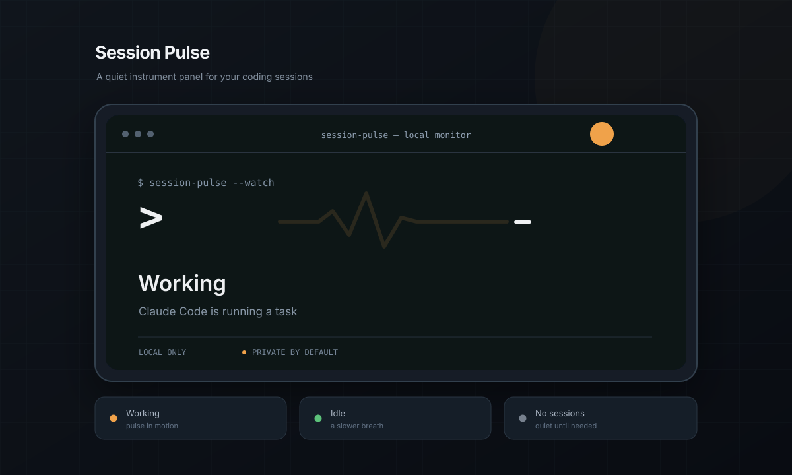
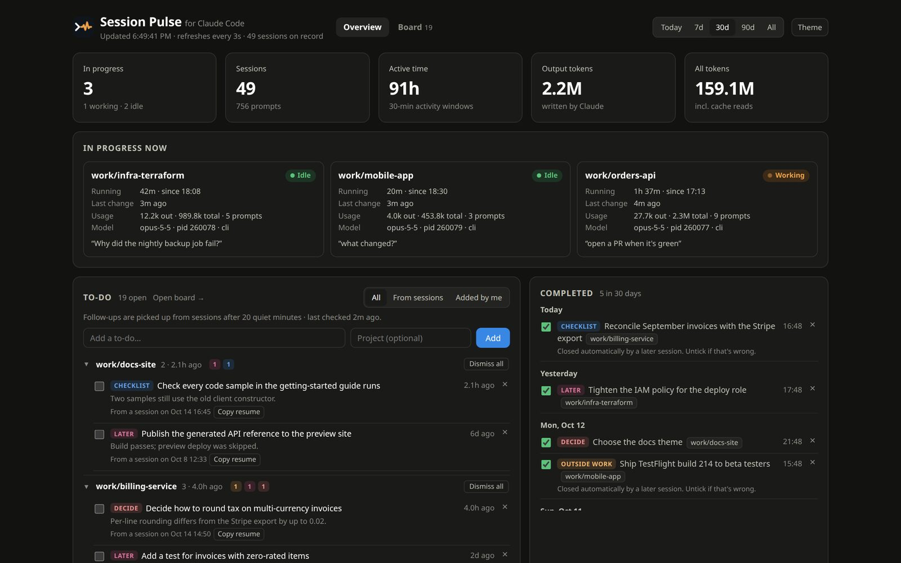
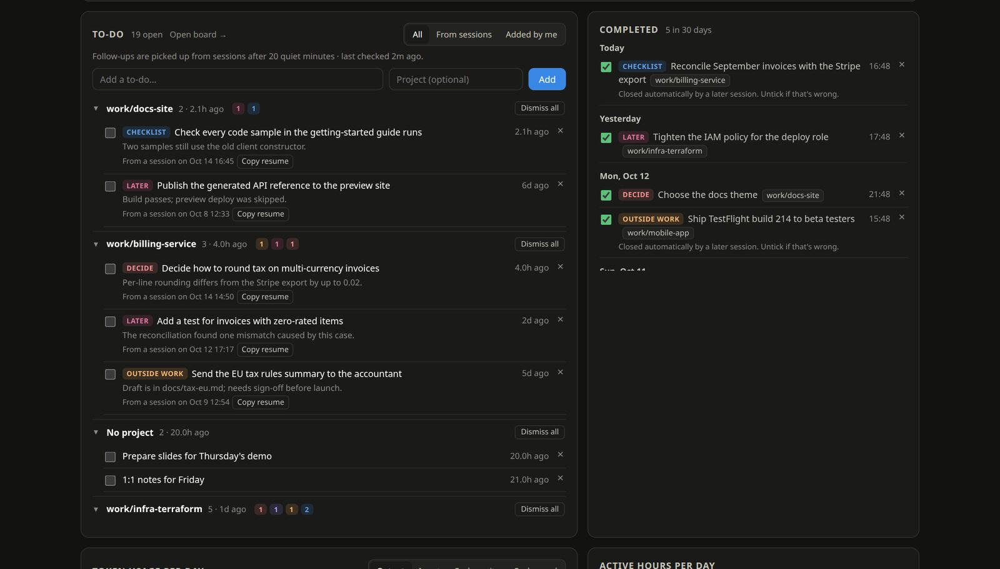
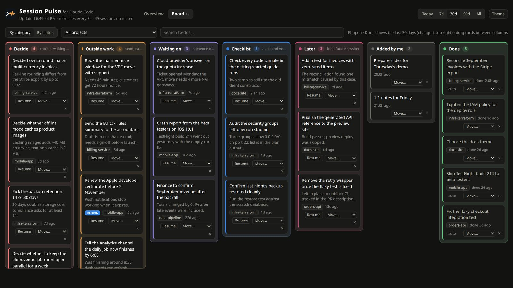
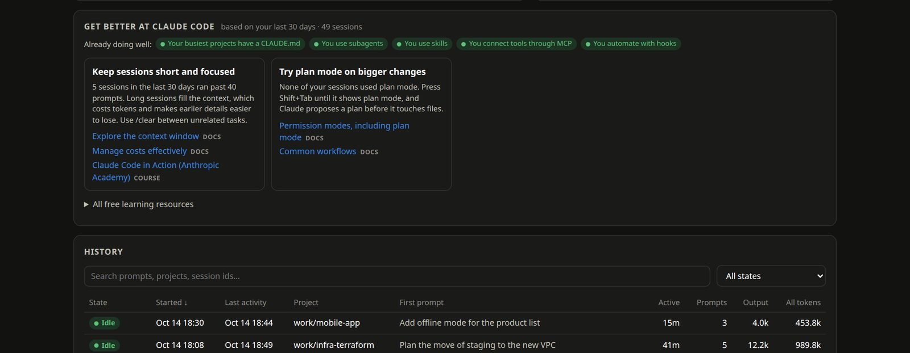
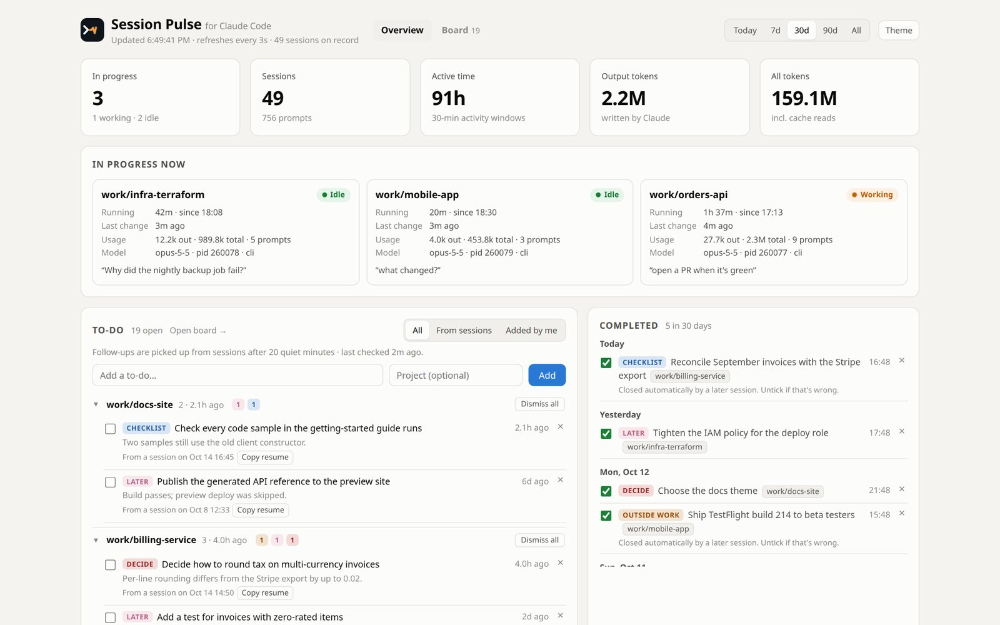

<h1 align="center">Session Pulse</h1>

<p align="center"><b>A quiet instrument panel for Claude Code.</b><br>
See every session at a glance, and never lose track of what a session left for you to do.</p>

<p align="center">
  <a href="https://github.com/vijayshuklaHL/sessionpulse/actions/workflows/test.yml"></a>
  
  
  
  <a href="LICENSE"></a>
  <!-- Once you have a Buy Me a Coffee page, uncomment this and put your handle in:
  <a href="https://buymeacoffee.com/YOUR_HANDLE"></a>
  -->
</p>

<p align="center"></p>

<!-- Demo video: on github.com, edit this README and drag the showcase .mp4 onto this line.
     GitHub hosts it and puts a player here, so the video doesn't bloat every clone.
     To make a fresh one: tools/showcase/run.sh -->


---

## Why

If you use [Claude Code](https://code.claude.com/docs/en/overview) every day, you probably have several sessions open across projects. Some are working, some are waiting for you, and some ended an hour ago with *"you still need to decide X, and someone has to approve Y"*. Those loose ends live in scrollback, and scrollback gets cleared.

Session Pulse sits next to your clock and keeps it all in one place:

- **What's running:** which sessions are open, working or idle, for how long, using how much.
- **What's left:** when a session goes quiet, Claude lists what it left open (decisions, outside work, checklists, things you're waiting on) and puts it on a board for you.
- **How you work:** tokens per day by model, real active hours, and tips to get better at Claude Code based on your own habits.

It reads the files Claude Code already writes under `~/.claude`. **Nothing leaves your machine.**

> Session Pulse is an independent project. It is not made, endorsed or supported by Anthropic.

## Screenshots

<p align="center"></p>

| To-dos that fill themselves | One board for everything you still owe |
|---|---|
|  |  |

| Get better at Claude Code | Light theme |
|---|---|
|  |  |

*All screenshots use made-up data (`tools/showcase/`).*

## Features

- **Live sessions:** working or idle, running time, last change, tokens, model. The panel icon shows the count and turns orange while Claude is working.
- **Follow-ups (optional):** Claude reads each session after 20 quiet minutes and adds what was left open to your to-do list, linked back to the session, with a one-click resume command. A later session that finishes an item closes it automatically.
- **Board:** every to-do as a card, colour-coded by kind (Decide, Outside work, Waiting on, Checklist, Later), or by status (To do, Doing, Done). Drag and drop, project filter, search.
- **Your own to-dos too:** add them on the dashboard or with `sessionpulse todo add "…"`.
- **Usage:** input, output and cache tokens per day, split by model; active hours per day; busiest projects.
- **Starts and exits:** when each session started and ended, and why (`/clear`, Ctrl+D, logout…).
- **History:** every session, searchable, with a copyable `claude --resume` command.
- **Get better at Claude Code:** suggestions picked from how you actually work (no `CLAUDE.md` in busy projects, very long sessions, features you haven't tried), with free official docs and Anthropic Academy courses.
- **Small and private:** standard library only, listens on `127.0.0.1`, needs a token, works in light and dark mode and on a phone screen.

## Install

Requires Python 3.11+ and Claude Code. Not on PyPI yet, so install straight from GitHub.

**Linux with the panel icon** (Ubuntu and Debian shown):

```sh
sudo apt install pipx python3-gi gir1.2-ayatanaappindicator3-0.1
pipx install --system-site-packages git+https://github.com/vijayshuklaHL/sessionpulse
sessionpulse install      # adds the start/exit hooks and a login autostart
sessionpulse tray &       # start the panel icon now
```

On GNOME you also need the AppIndicator extension. Ubuntu has it on by default; elsewhere install "AppIndicator and KStatusNotifierItem Support". KDE, Xfce, Cinnamon and MATE need nothing extra.

**macOS, or without the panel icon:**

```sh
pipx install git+https://github.com/vijayshuklaHL/sessionpulse
sessionpulse install --no-autostart
sessionpulse serve        # then, in another terminal:  sessionpulse open
```

**Turn on follow-ups** (optional, see [what it costs](#follow-ups)):

```sh
mkdir -p ~/.config/sessionpulse
echo 'followups = true' >> ~/.config/sessionpulse/config.toml
sessionpulse followups    # read the last 30 days now instead of waiting
```

Check everything with `sessionpulse doctor`. Remove it with `sessionpulse uninstall` (your data stays) and `pipx uninstall sessionpulse`.

## Commands

| Command | What it does |
|---|---|
| `sessionpulse install` | Adds SessionStart/SessionEnd hooks to `~/.claude/settings.json` (after backing it up) and a login autostart entry |
| `sessionpulse uninstall` | Removes exactly those hooks and the autostart entry. Your data stays. |
| `sessionpulse tray` | Panel icon and dashboard server |
| `sessionpulse serve` | Dashboard server only |
| `sessionpulse open` | Opens the dashboard in your browser, signed in (add `#board` to the address for the board) |
| `sessionpulse doctor` | Checks the setup and warns if Claude Code's file formats look different |
| `sessionpulse todo [add TEXT -p PROJECT \| done ID \| undo ID \| delete ID \| list-done]` | Your to-do list from the terminal |
| `sessionpulse followups [--days N] [--session ID] [--now] [--again]` | Read recent sessions now and add their open follow-ups |
| `sessionpulse snapshot` | Prints the dashboard data as JSON |

## Settings

Optional. Create `~/.config/sessionpulse/config.toml` with any of these keys:

```toml
port = 8765              # dashboard port (on 127.0.0.1)
refresh_seconds = 5
claude_dir = "~/.claude" # defaults to $CLAUDE_CONFIG_DIR if that is set
gap_minutes = 30         # activity closer together than this counts as one block of active time
min_block_minutes = 15   # shortest block of active time
followups = false        # true: pick open follow-ups out of quiet sessions
followups_model = "haiku"
followups_idle_minutes = 20
followups_days = 30
followups_parallel = 3
claude_command = ""      # path to `claude` if it isn't on PATH
```

### Follow-ups

Off by default, because it uses Claude. When on, the dashboard server checks every 5 minutes for sessions that have been quiet for 20 minutes and changed since it last read them. It sends their prompts and Claude's replies to `claude -p` (Haiku by default) and asks only for what's still open. That counts toward your Claude usage: roughly one small Haiku request per session.

The request runs with all hooks disabled and `--no-session-persistence`, so it never shows up as a session, in this dashboard or in any hook of yours. Items you dismiss are remembered and not picked up again.

## Privacy and security

Transcripts contain everything you type into Claude Code, so the dashboard is locked down:

- It listens on `127.0.0.1` only and rejects requests addressed to any other host name (no DNS rebinding).
- It needs an access token, stored in `~/.local/share/sessionpulse/token` (readable only by you). `sessionpulse open` and the panel menu pass it once; after that it lives in an HttpOnly, SameSite=Strict cookie. The first link with the token in it may stay in your browser history.
- Changing to-dos needs the cookie, a JSON request and a matching Origin, so other web pages can't add or delete items.
- Only the artwork under `/brand/` is served without the token.
- It never writes to Claude Code's files, except `install`/`uninstall`, which edit the `hooks` section of `settings.json` after a timestamped backup.

Found a problem? See [SECURITY.md](SECURITY.md).

## How the numbers are worked out

- **Live status** comes from `~/.claude/sessions/<pid>.json`. A session counts as live only while its process is running.
- **Tokens** come from the `usage` field of assistant messages. Each API response is counted once, and subagent usage is added to the session that started it.
- **Active time** groups activity into blocks: messages less than 30 minutes apart belong to one block, and every block counts as at least 15 minutes.
- **Exits** are recorded by the SessionEnd hook, so sessions that ended before you ran `install` show as "Closed".
- **Cost** is not shown. On a subscription, tokens don't map to a bill, and API prices change.

**These file formats are internal to Claude Code and undocumented.** Session Pulse reads them defensively, and the dashboard and `sessionpulse doctor` warn when lines stop parsing, usage disappears, or the Claude Code version is newer than the one last tested. If you see a warning, please [open an issue](https://github.com/vijayshuklaHL/sessionpulse/issues) with your Claude Code version.

## Fork it and make it yours

Session Pulse is small on purpose (a few Python files and one HTML page, no build step), so it's easy to bend to how you work. Some ideas:

| You want to… | Look at |
|---|---|
| Change the colours or layout | the `:root` tokens and sections in `src/sessionpulse/static/dashboard.html` |
| Use your own logo or artwork | `src/sessionpulse/static/brand/` and `src/sessionpulse/icons/` |
| Add your team's own learning links or habits to check | `LIBRARY` and `suggest()` in `src/sessionpulse/learn.py` |
| Change what counts as a follow-up, or the categories | `SYSTEM` and `KINDS` in `src/sessionpulse/followups.py` and `todos.py` |
| Send follow-ups somewhere else (Linear, Jira, a chat channel) | `todos.merge_followups()` is the one place new items land |
| Record your own demo video | `tools/showcase/run.sh` (needs Chrome, Node 20+, ffmpeg; uses made-up data) |

```sh
git clone https://github.com/<you>/sessionpulse && cd sessionpulse
python3 -m unittest discover -s tests          # 38 tests, a few seconds
PYTHONPATH=src python3 -m sessionpulse serve   # then: PYTHONPATH=src python3 -m sessionpulse open
```

If you build something others would like, a pull request is very welcome. See [CONTRIBUTING.md](CONTRIBUTING.md). The MIT licence only asks that you keep the copyright notice.

## Support

If Session Pulse saves you time:

- ⭐ **Star the repo.** It helps other Claude Code users find it.
- 🐛 **Report bugs or ideas** in [Issues](https://github.com/vijayshuklaHL/sessionpulse/issues).
- ☕ **Buy me a coffee:** link coming soon.
  <!-- Replace the line above with: [Buy me a coffee](https://buymeacoffee.com/YOUR_HANDLE) -->

## Licence

[MIT](LICENSE) © 2026 Vijay Shukla. Claude and Claude Code are trademarks of Anthropic, used here only to say what this tool works with.
